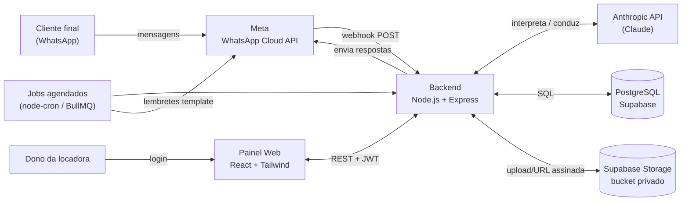
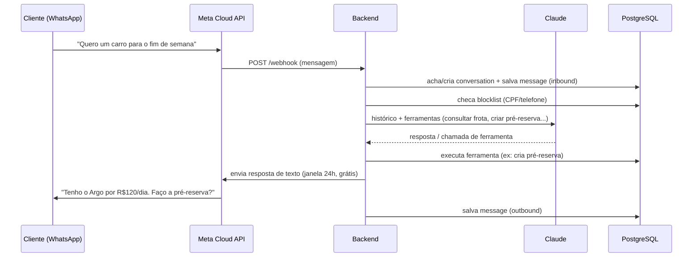
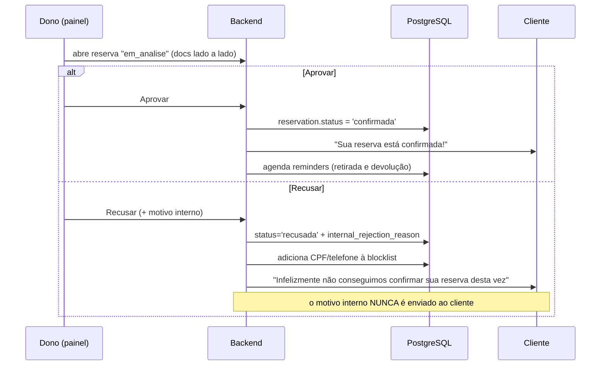
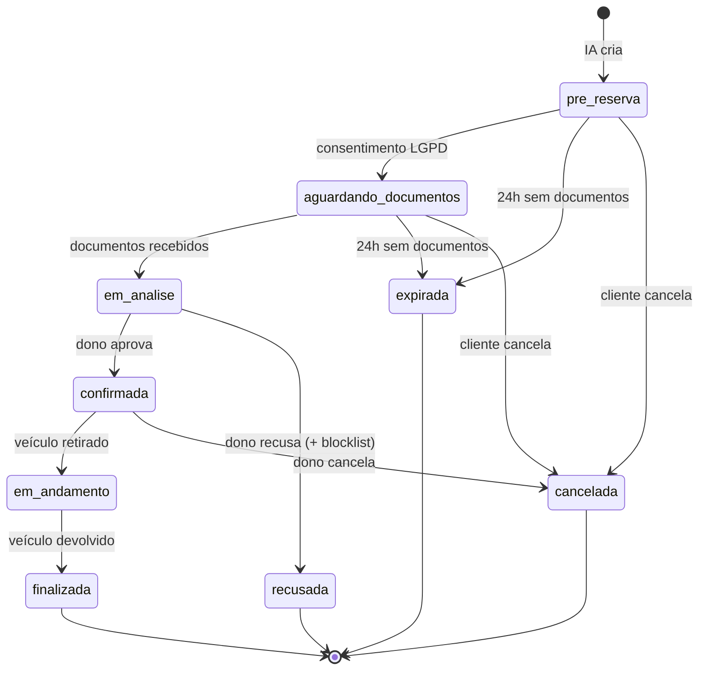
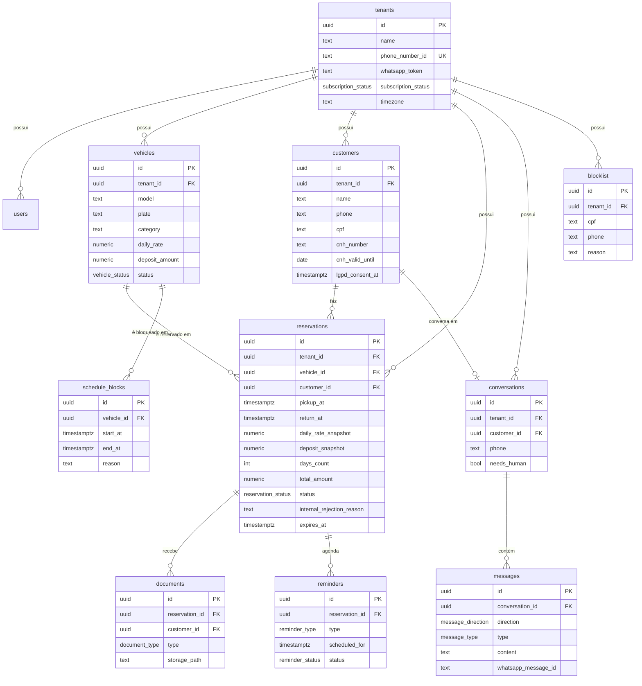

# Arquitetura — SaaS de Reservas via WhatsApp para Locadoras

> Documento de referência da **Etapa 1**. Descreve a visão geral, os fluxos
> principais, o modelo de dados completo e a estrutura de pastas prevista.
> Os diagramas usam Mermaid (o VS Code renderiza com a extensão "Markdown
> Preview Mermaid Support", ou no próprio GitHub).

---

## 1. Visão geral

O produto é um **SaaS multi-tenant**: cada locadora ("tenant") tem seu próprio
número de WhatsApp e conversa com seus clientes por uma IA (Claude). A IA
interpreta a mensagem, mostra veículos disponíveis, faz uma **pré-reserva**,
coleta documentos e **nunca confirma nada sozinha** — quem aprova/recusa é
sempre o dono, pelo painel web.

### Componentes



| Camada | Tecnologia | Papel |
|---|---|---|
| Backend/API | Node.js + Express | Webhook, regras de negócio, orquestração da IA |
| Banco | PostgreSQL (Supabase) | Persistência, constraints de disponibilidade |
| Storage | Supabase Storage (privado) | Documentos dos clientes (URLs assinadas) |
| Mensageria | Meta WhatsApp Cloud API | Enviar/receber texto e imagens, templates |
| IA | Anthropic (Claude) | Interpretar mensagens e conduzir a conversa |
| Jobs | node-cron (MVP) → BullMQ | Lembretes e expiração de pré-reservas |
| Painel | React + Tailwind (Vite) | Interface do dono da locadora |

> **MVP:** começamos com **node-cron** (mais simples, um único processo).
> Quando o volume crescer, migramos os jobs para **BullMQ + Redis** sem mudar
> o modelo de dados (a tabela `reminders` já funciona como fila persistente).

---

## 2. Multi-tenant

Todas as tabelas de negócio têm `tenant_id`. O roteamento acontece assim:

- Cada locadora cadastra seu **`phone_number_id`** (da Meta) na tabela `tenants`.
- Quando chega um webhook, o payload traz o `phone_number_id` que **recebeu** a
  mensagem → o backend descobre o tenant por esse campo.
- Toda query do painel filtra por `tenant_id` (o usuário logado pertence a um
  tenant). Nenhuma locadora enxerga dados de outra.

> Em produção podemos ativar **RLS (Row Level Security)** no Supabase como
> reforço. No MVP, o backend usa a *service role key* e aplica o filtro de
> `tenant_id` em todas as consultas.

---

## 3. Fluxos principais

### 3.1 Mensagem recebida (texto)



### 3.2 Coleta de documentos

```mermaid
sequenceDiagram
    participant C as Cliente
    participant B as Backend
    participant S as Storage privado
    participant DB as PostgreSQL

    B->>C: pede consentimento LGPD
    C->>B: aceita
    B->>DB: grava customers.lgpd_consent_at
    B->>C: pede CNH (frente/verso), comprovante, selfie
    C->>B: envia imagem (media_id)
    B->>B: baixa mídia via media_id (Cloud API)
    B->>S: upload no bucket privado
    B->>DB: cria documents (storage_path, type, reservation_id)
    Note over B,DB: pré-reserva sem docs expira em 24h;<br/>lembrete após algumas horas
```

### 3.3 Análise e decisão (sempre do dono)



### 3.4 Ciclo de vida da reserva



> **Disponibilidade:** os status `pre_reserva`, `aguardando_documentos`,
> `em_analise`, `confirmada` e `em_andamento` "ocupam" a agenda do veículo.
> `cancelada`, `recusada`, `expirada` e `finalizada` **liberam** o período.

---

## 4. Modelo de dados

Diagrama entidade-relacionamento (colunas resumidas; o detalhe completo está em
[`db/schema.sql`](db/schema.sql)).



### Tabelas em uma frase

| Tabela | O que guarda |
|---|---|
| `tenants` | As locadoras (nome, número WhatsApp, token, assinatura). |
| `users` | Usuários do painel (dono/funcionário), login por tenant. |
| `vehicles` | Frota: modelo, placa, categoria, diária, caução, status. |
| `customers` | Locatários: nome, telefone, CPF, CNH, consentimento LGPD. |
| `reservations` | Reservas com período, valores congelados e ciclo de vida. |
| `schedule_blocks` | Períodos de manutenção/indisponibilidade do veículo. |
| `documents` | Referências das imagens no storage privado. |
| `blocklist` | Clientes bloqueados por CPF/telefone, com motivo interno. |
| `conversations` | Um fio de conversa por telefone, flag "precisa de humano". |
| `messages` | Histórico completo (também é o contexto da IA). |
| `reminders` | Fila de lembretes de retirada e devolução. |
| `webhook_events` | Deduplicação dos eventos da Meta (idempotência). |
| `verification_checks` | Preparação futura (consulta CPF/CNH/antecedentes). |

### Decisões de modelagem importantes

1. **Sem sobreposição de reservas (garantido no banco).**
   `reservations` tem uma `EXCLUDE ... USING gist` sobre `(vehicle_id, tstzrange(pickup_at, return_at))`
   restrita aos status ativos. Duas reservas ativas do mesmo veículo com períodos
   que se cruzam são **rejeitadas pelo próprio PostgreSQL**, não apenas pela
   lógica da conversa. Um `INSERT` concorrente que criaria conflito falha na
   transação.

2. **Reserva x manutenção.** Como a constraint acima é de uma tabela só, há dois
   *triggers* cruzados (`reservations` ↔ `schedule_blocks`) que impedem uma
   reserva de cair sobre um bloqueio e vice-versa.

3. **Valores congelados.** A reserva guarda `daily_rate_snapshot` e
   `deposit_snapshot`. Se o preço do veículo mudar depois, as reservas antigas
   preservam o valor cobrado.

4. **Motivo de recusa protegido.** `internal_rejection_reason` existe no banco,
   mas nenhuma rota que fala com o cliente lê esse campo — a mensagem ao cliente
   é sempre genérica.

5. **Idempotência do webhook.** `messages.whatsapp_message_id` é único e
   `webhook_events` registra os eventos processados, para a Meta reenviar sem
   duplicar reservas/mensagens.

---

## 5. Segurança e LGPD

- **Documentos** ficam em **bucket privado**; o painel os acessa por **URL
  assinada temporária** (nunca URL pública).
- **Consentimento** registrado em `customers.lgpd_consent_at` (data/hora).
- **Direito ao esquecimento:** rotina/endpoint que apaga todos os dados de um
  cliente (registros + arquivos no storage). O `ON DELETE CASCADE` das tabelas
  facilita a remoção em cascata; os arquivos são removidos do bucket junto.
- **Tokens** de WhatsApp por tenant são **cifrados no banco** (AES-256-GCM, via
  `ENCRYPTION_KEY`); o backend decifra só na hora de chamar a Meta. Leitura
  retrocompatível (token legado em texto puro segue funcionando até migrar com
  `npm run encrypt:tokens`).
- **Autenticação:** JWT (bcrypt nas senhas); em produção `JWT_SECRET` é
  obrigatório (≥32 chars) e o bypass por header fica desligado.
- **Abuso:** rate limit no login (força bruta) e teto geral na API; CORS
  restringível por origem; `helmet` nos headers.
- **Segredos** só no `.env` (fora do versionamento).

---

## 6. Estrutura de pastas (prevista)

```
SISTEMA LOCADORAS/
├── ARCHITECTURE.md          # este documento
├── README.md
├── .env.example
├── .gitignore
├── package.json             # (etapa 2a)
├── db/
│   ├── schema.sql           # modelo de dados completo  ✅ etapa 1
│   └── seed.sql             # dados de exemplo           (etapa 2a)
├── src/
│   ├── server.js            # bootstrap do Express
│   ├── config/
│   │   ├── env.js           # validação das variáveis de ambiente
│   │   ├── db.js            # pool do PostgreSQL
│   │   └── supabase.js      # client do Storage
│   ├── middleware/
│   │   ├── auth.js          # JWT do painel
│   │   └── tenant.js        # resolve tenant pelo phone_number_id
│   ├── routes/
│   │   ├── webhook.js       # GET verificação + POST mensagens
│   │   ├── auth.js
│   │   ├── vehicles.js
│   │   ├── reservations.js
│   │   ├── documents.js
│   │   ├── conversations.js
│   │   └── customers.js
│   ├── services/
│   │   ├── whatsapp.js      # enviar/baixar mídia/templates
│   │   ├── availability.js  # cálculo de disponibilidade
│   │   ├── reservations.js  # regras de negócio
│   │   ├── documents.js     # storage privado
│   │   ├── reminders.js
│   │   ├── blocklist.js
│   │   ├── lgpd.js          # exclusão de dados do cliente
│   │   ├── ai/
│   │   │   ├── agent.js     # orquestra Claude + ferramentas
│   │   │   ├── tools.js     # ferramentas expostas à IA
│   │   │   └── prompts.js   # instruções do sistema
│   │   └── verification/
│   │       └── provider.js  # interface futura (CPF/CNH) — mock no MVP
│   ├── jobs/
│   │   ├── scheduler.js     # node-cron
│   │   ├── expirePreReservations.js
│   │   └── sendReminders.js
│   └── repositories/        # acesso a dados por tabela
└── web/                     # painel React + Tailwind (Vite)  (etapa 7)
```

---

## 7. Roadmap por etapas

| Etapa | Entrega | Status |
|---|---|---|
| 1 | Arquitetura + modelo de dados (`schema.sql`) | ✅ concluída |
| 2a | Banco + API base (config, conexão, CRUD de frota) | ✅ concluída |
| 2b | Webhook + integração Meta Cloud API (texto e imagem) | ✅ concluída |
| 2c | Lógica de reservas e disponibilidade | ✅ concluída |
| 2d | Integração com a IA (Claude + ferramentas) | ✅ concluída |
| 2e | Fluxo de documentos (consentimento, upload, análise) | ✅ concluída |
| 2f | Lembretes com templates | ✅ concluída |
| 2g | Painel web (agenda, frota, análise, blocklist) | ✅ concluída |

A cada etapa: explicação do que foi feito, como testar localmente e uma
**revisão geral** de código antes de seguir.
