# LocCar — Reservas no WhatsApp para locadoras de veículos

[](https://github.com/DexxGomes/loccar-portfolio/actions/workflows/ci.yml)

<p align="center">
  
</p>

> 🇺🇸 **In English:** LocCar is a multi-tenant SaaS for car rental companies. Customers chat on the
> company's WhatsApp, an AI agent (Claude) checks availability, quotes prices and creates a
> pre-booking, and the owner approves it in a React web panel that also runs the fleet,
> inspections, contracts and finances. Built with Node.js, Express, PostgreSQL (Supabase) and React.

SaaS multi-locadora em que o cliente final conversa pelo **WhatsApp da locadora**,
uma **IA (Claude, da Anthropic)** entende o pedido, mostra os carros livres com
preço e faz uma **pré-reserva**. O dono recebe os documentos do cliente,
analisa e **aprova ou recusa pelo painel web**, que também cuida da frota, das
vistorias, do financeiro e dos contratos.

> A IA **nunca confirma uma reserva sozinha**. Toda pré-reserva passa pela
> análise do dono, e a decisão é sempre dele.

---

## 📸 Prints de tela

Computador à esquerda, celular à direita: o painel foi pensado primeiro para o
celular. Todos os dados dos prints são **fictícios**.

**Hoje** — a primeira tela depois do login: o que precisa de você, em ordem de urgência.

<table>
  <tr>
    <td width="75%">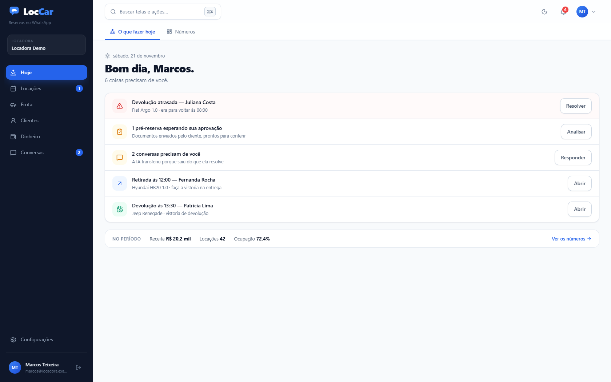</td>
    <td>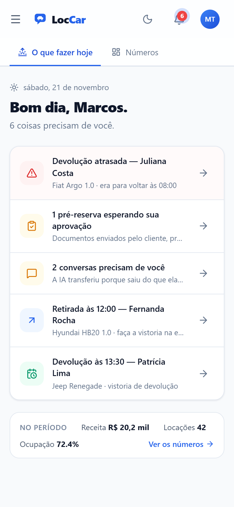</td>
  </tr>
</table>

**Conversa no WhatsApp** — a IA mostra os carros livres com preço, faz a pré-reserva, recebe a
CNH e passa para um humano quando o pedido sai do que ela pode decidir.

<table>
  <tr>
    <td width="75%">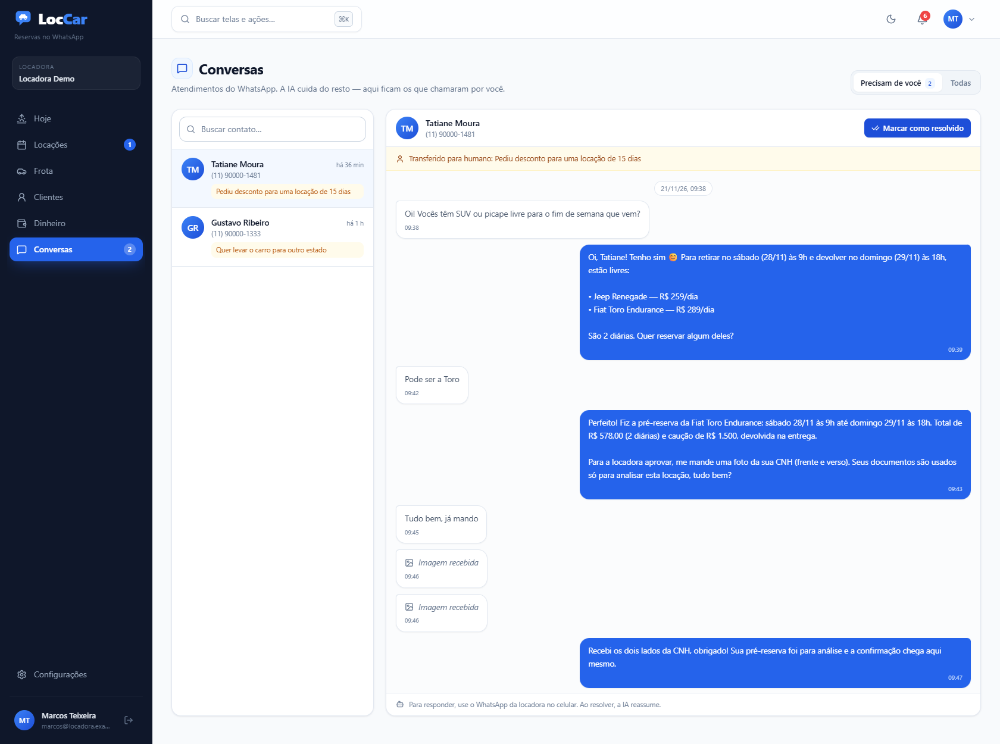</td>
    <td>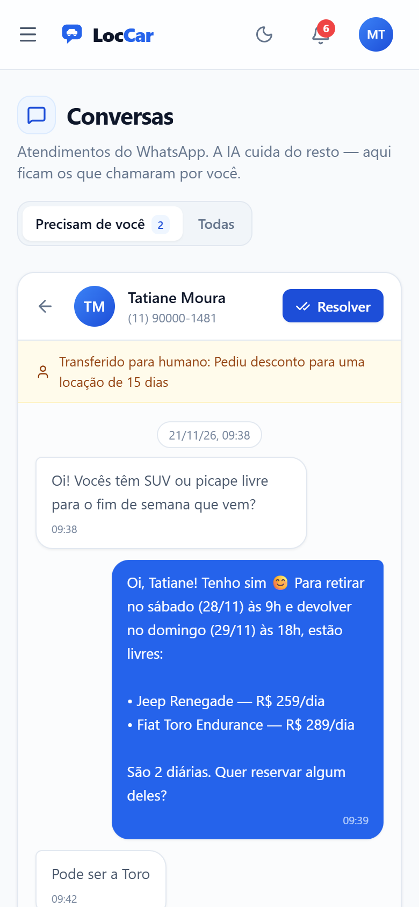</td>
  </tr>
</table>

**Linha do tempo da frota** — o mês inteiro: o que sai (▲) e o que volta (▼) em cada dia, com
atrasos destacados.

<table>
  <tr>
    <td width="75%">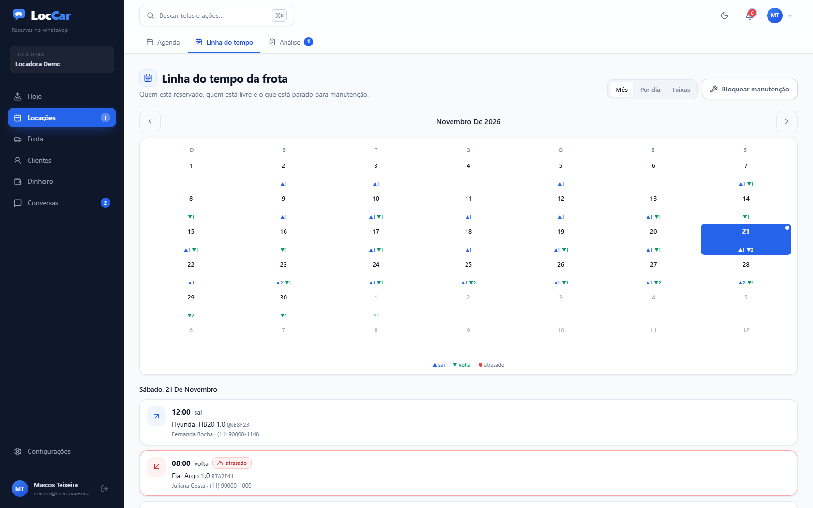</td>
    <td>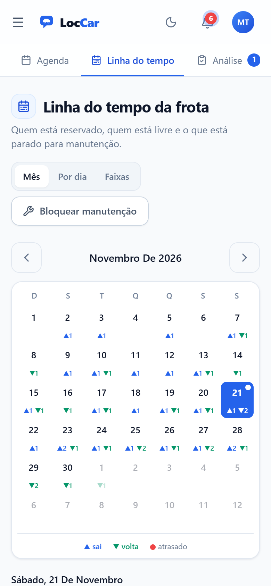</td>
  </tr>
</table>

**Vistoria digital** — quilometragem, combustível e avarias marcadas no desenho do carro, na
retirada e na devolução, com o que mudou calculado sozinho.

<table>
  <tr>
    <td width="75%">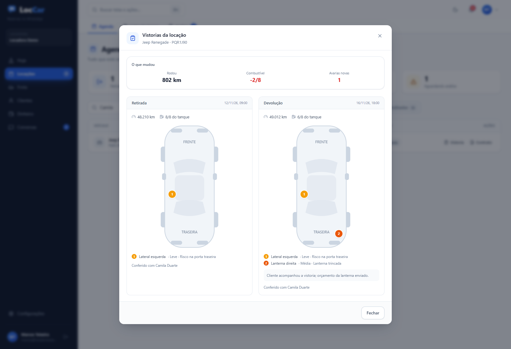</td>
    <td>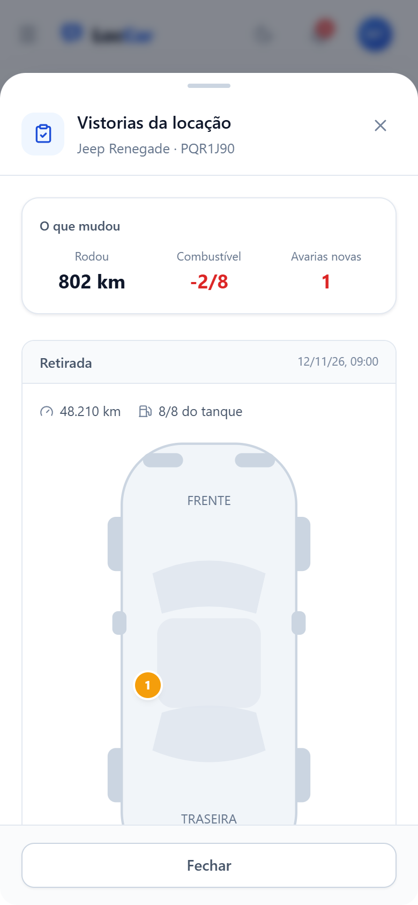</td>
  </tr>
</table>

**Painel executivo** — receita, ocupação, ticket médio, funil do WhatsApp até a locação e os
veículos que mais faturam.

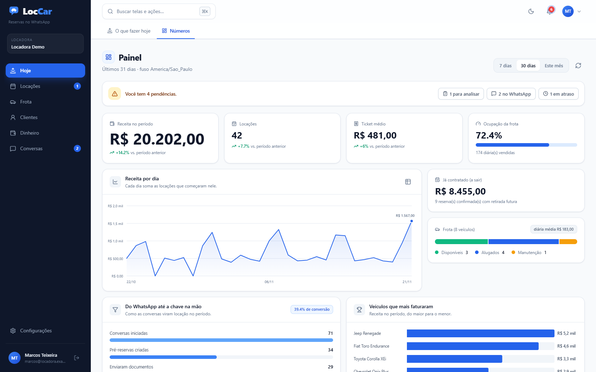

**Dinheiro** — entrou, gastou, sobrou, e o que ainda está em aberto hoje.

<table>
  <tr>
    <td width="75%">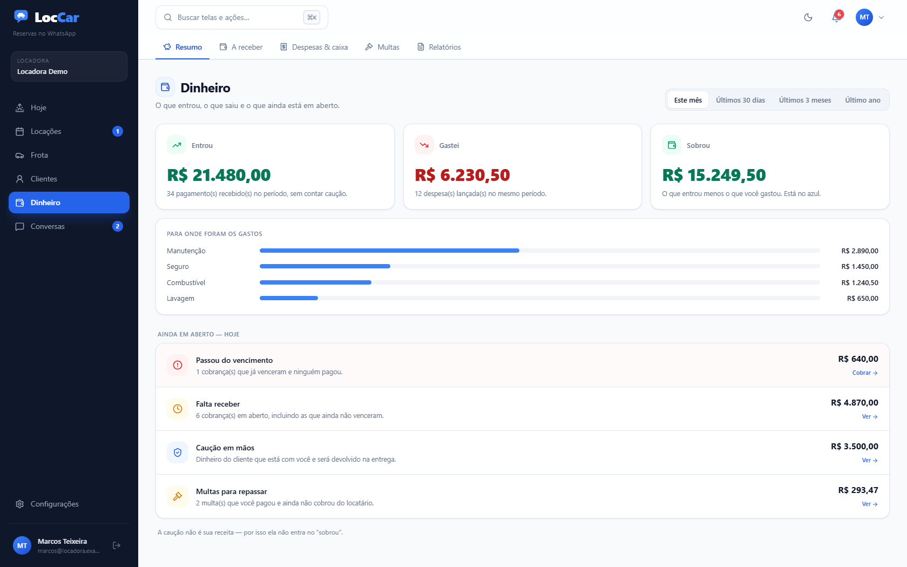</td>
    <td>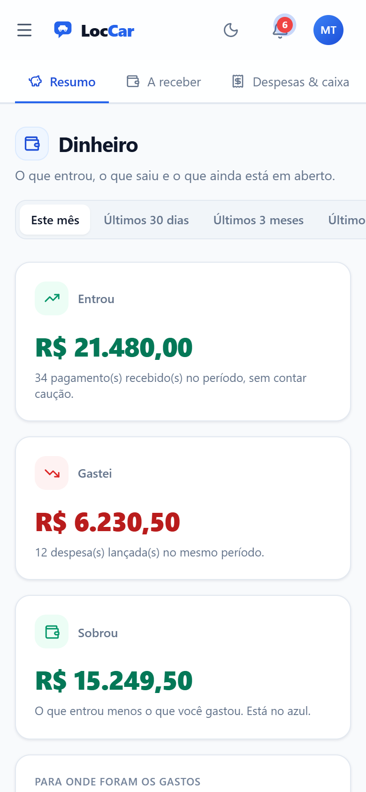</td>
  </tr>
</table>

**Leads** — funil de possíveis clientes em kanban, com aviso de quem está parado há dias.

<table>
  <tr>
    <td width="75%">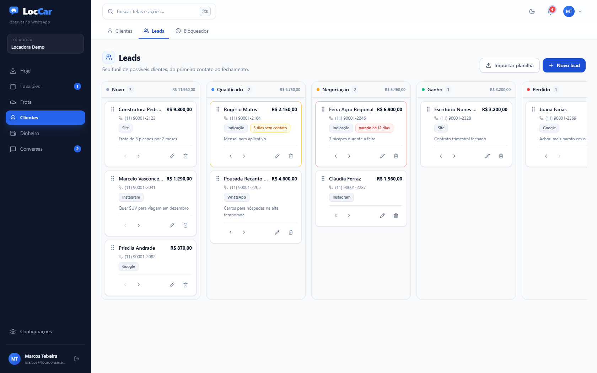</td>
    <td>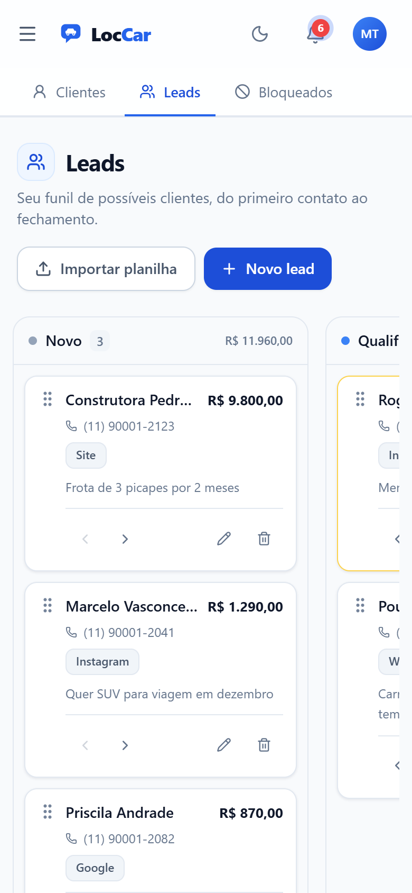</td>
  </tr>
</table>

**Tema escuro**

<table>
  <tr>
    <td width="50%">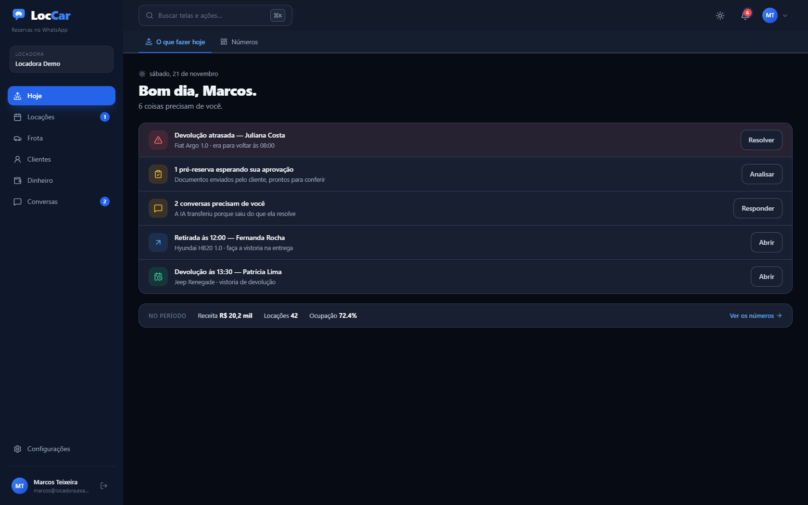</td>
    <td width="50%">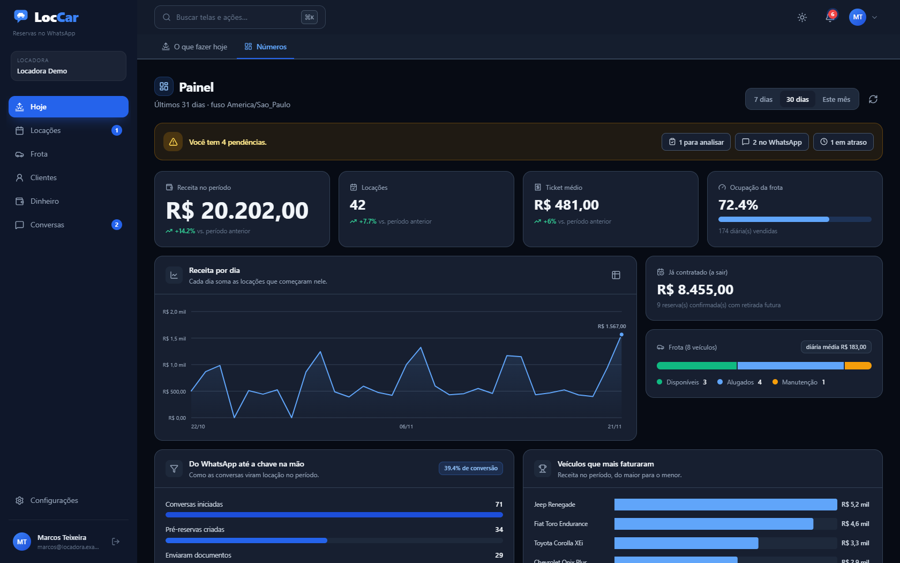</td>
  </tr>
</table>

---

## 🧰 Tecnologias

**Backend**
- Node.js + Express (ES Modules)
- PostgreSQL no Supabase, acessado com o driver `pg` (SQL puro, sem ORM)
- Supabase Storage com bucket **privado** e links assinados que expiram
- Zod para validar as entradas · JWT + bcrypt para login · Helmet e rate limit
- node-cron para tarefas agendadas (lembretes, expiração de pré-reservas, retenção de documentos)

**Inteligência artificial e integrações**
- Anthropic Claude com *tool use*: 8 ferramentas que a IA chama (consultar disponibilidade, criar/remarcar/cancelar pré-reserva, atualizar dados do cliente, registrar consentimento LGPD, chamar um humano…)
- Meta WhatsApp Cloud API (oficial), com verificação da assinatura do webhook
- Transcrição de áudio do WhatsApp (API compatível com Whisper: OpenAI ou Groq)
- Asaas para cobrança PIX (opcional) · ViaCEP para preencher endereço

**Painel web**
- React 18 + Vite + Tailwind CSS · React Router · ícones Lucide
- Gráficos em SVG feitos à mão (sem biblioteca de gráficos)
- Tema claro e escuro, pensado primeiro para o celular

**Qualidade**
- 158 testes de integração com o *test runner* nativo do Node, rodando contra um banco real
- Testes que renderizam as telas do painel fora do navegador (esbuild + `react-dom/server`)
- GitHub Actions a cada push: render das telas, build do painel e checagem de sintaxe da API
- Especificação *spec-anchored*: cada critério de aceite em `.spec/` é ligado a um teste com `@spec:AC-xxx`

---

## ✨ Funcionalidades

**Atendimento no WhatsApp**
- A IA responde a qualquer hora, mostra os carros livres no período com o valor total e faz a pré-reserva
- Coleta CNH e selfie pela própria conversa e manda a reserva para análise
- Entende mensagem de áudio (transcrição antes da IA)
- **Número compartilhado:** a locadora pode usar o mesmo WhatsApp da família. Contatos particulares são descartados antes de virar cliente, e uma triagem sem custo decide se a mensagem é sobre aluguel antes de chamar a IA
- Passa a conversa para um humano quando o assunto foge do escopo, e avisa o dono
- Lembretes automáticos 24 h antes da retirada e da devolução (templates aprovados pela Meta)

**Painel da locadora**
- **Hoje:** lista do que precisa de você, em ordem de urgência, cada item com o botão que resolve
- **Painel executivo:** receita, ocupação da frota, ticket médio, funil do WhatsApp até a locação e ranking de veículos, sempre comparando com o período anterior
- **Linha do tempo:** calendário do mês (o que sai e o que volta por dia), visão por dia e Gantt por veículo, com bloqueios de manutenção
- **Análise de documentos:** galeria com zoom, checklist e alertas automáticos (ex.: CNH que vence antes da devolução)
- **Vistoria digital** na retirada e na devolução: fotos, quilometragem, combustível e avarias marcadas no desenho do carro, com o comparativo calculado no servidor
- **Contrato** gerado a partir da reserva, com os dados do locatário
- **Dinheiro:** entrou − gastou = sobrou, contas a receber (diárias, caução, extras), despesas, multas e cobrança PIX
- **Leads** em kanban que funciona com o dedo no celular, com aviso de lead parado
- Frota, clientes (endereço preenchido pelo CEP), blocklist, relatório mensal em PDF e guia de primeiros passos
- Login por CPF ou e-mail, com troca de senha obrigatória no primeiro acesso

**Regras de negócio garantidas pelo banco**
- Dois aluguéis do mesmo carro no mesmo horário são impossíveis: uma *EXCLUDE constraint* do PostgreSQL barra a sobreposição mesmo em condição de corrida, não só a lógica da aplicação
- Os valores ficam congelados na reserva; mudar o preço do carro não altera reservas já feitas
- Manutenção e reserva não se sobrepõem (gatilhos no banco)

**Segurança e LGPD**
- Isolamento entre locadoras em todas as consultas, com testes de IDOR provando que uma locadora não lê nem altera dado de outra
- Row Level Security no Supabase fechando o acesso direto às tabelas
- Token do WhatsApp de cada locadora cifrado com AES-256-GCM
- Registro de auditoria de quem acessou a ficha de cada cliente
- Exclusão de dados do cliente a pedido (LGPD) e retenção configurável dos documentos
- Política de segurança de conteúdo (CSP) no painel e rotas sensíveis atrás de login

---

## 🚀 Como instalar e rodar

### Pré-requisitos

- Node.js 20 ou superior
- Um projeto no [Supabase](https://supabase.com) (o plano grátis serve). Use um projeto **só de desenvolvimento**: os testes criam e apagam dados nele.
- Opcional: chave da Anthropic (para a IA) e um app na Meta (para o WhatsApp)

### 1. API (backend)

```bash
git clone https://github.com/DexxGomes/loccar-portfolio.git
cd loccar-portfolio

npm install
cp .env.example .env        # preencha pelo menos DATABASE_URL e JWT_SECRET

npm run db:schema           # cria as tabelas
npm run db:migrate          # aplica as migrações em db/migrations
npm run db:seed             # cria uma locadora de demonstração com 4 carros
npm run create:owner -- dono@locadora.com "Dono da Locadora" 12345678909
#                          e-mail            nome               CPF (11 dígitos)

npm run dev                 # API em http://localhost:3000
```

O `create:owner` gera uma senha inicial forte e mostra no terminal. No primeiro
acesso o painel pede para trocar.

O passo a passo de cada chave (banco, storage, IA, WhatsApp, PIX) está em
[docs/CONEXOES.md](docs/CONEXOES.md).

### 2. Painel (web)

```bash
cd web
npm install
npm run dev                 # painel em http://localhost:5173
```

Entre com o CPF (ou o e-mail) e a senha gerada no passo anterior. Depois de instalar as dependências
das duas pastas, `npm run dev:all` na raiz sobe a API e o painel juntos.

### 3. WhatsApp (opcional)

Siga [docs/WHATSAPP_SETUP.md](docs/WHATSAPP_SETUP.md). Dá para testar com o
número de teste gratuito da Meta e um túnel como o ngrok.

### Testes

```bash
npm test                    # testes de integração da API (precisa do banco configurado)
npm run test:web            # renderiza as telas do painel e procura erros
npm run test:tudo           # os dois
```

---

## 🗂️ Estrutura

```
src/
  routes/         rotas HTTP do painel e o webhook do WhatsApp
  services/       regras de negócio (reservas, vistoria, financeiro, LGPD…)
  services/ai/    agente Claude: prompt, ferramentas e laço de tool use
  repositories/   SQL, uma pasta de consultas por assunto
  jobs/           tarefas agendadas
  middleware/     login, auditoria e tratamento de erros
db/               schema.sql, seed.sql e migrações numeradas
web/              painel React (Vite + Tailwind)
tests/            testes de integração
.spec/            especificação das 15 funcionalidades, com critérios de aceite
docs/             guias de configuração
```

A arquitetura completa, os fluxos e o modelo de dados estão em
[ARCHITECTURE.md](ARCHITECTURE.md).

---

## 👤 Autor

Desenvolvido por **[DexxGomes](https://github.com/DexxGomes)**.
